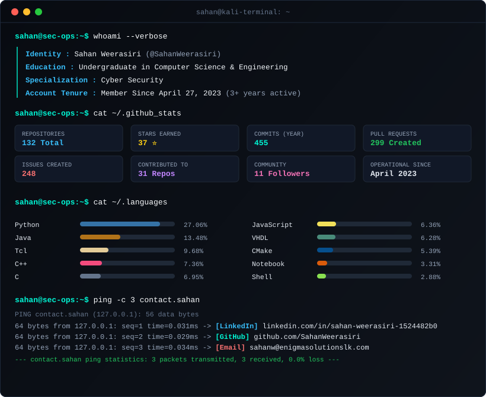

```text
┌──(sahan㉿terminal)-[~]
└─$ cat /etc/motd
  ____        _                  __        __                      _      _ 
 / ___|  __ _| |__   __ _ _ __   \ \      / /__  ___ _ __ __ _ ___(_)_ __(_)
 \___ \ / _` | '_ \ / _` | '_ \   \ \ /\ / / _ \/ _ \ '__/ _` / __| | '__| |
  ___) | (_| | | | | (_| | | | |   \ V  V /  __/  __/ | | (_| \__ \ | |  | |
 |____/ \__,_|_| |_|\__,_|_| |_|    \_/\_/ \___|\___|_|  \__,_|___/_|_|  |_|
```

<p align="center">
  
</p>

<p align="center">
  <a href="https://www.linkedin.com/in/sahan-weerasiri-1524482b0"></a>
  <a href="mailto:sahanw@enigmasolutionslk.com"></a>
  <a href="https://github.com/SahanWeerasiri"></a>
</p>

---

<p align="center">
  
</p>

---

### 📊 Real-Time GitHub Activity

<p align="center">
  
  
</p>
